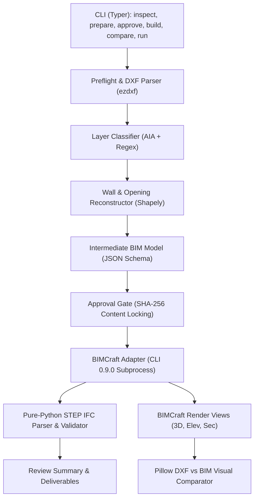

# Milestone 10 Audit: Universal DXF Workflow & Guided Approval

**Engine**: BIMCraft CLI 0.9.0  
**Baseline Test Status**: 40/40 tests passed (4.34s)  
**Date**: October 30, 2026  
**Auditor**: Senior Python Engineer & BIM Automation Architect  

---

## 1. Executive Summary

The **DXF-to-3D-BIM** project has achieved a verified baseline (Milestones 1–9) with 40 passing tests, reliable IFC4 generation, STEP-level semantic validation, and visual rendering (3D axonometric, elevations, section, and comparison overlay).

However, the existing workflow relies on idealized conditions:
- The `inspect` command performs only a superficial entity tally.
- Missing or ambiguous units ($INSUNITS = 0) fall back to millimetres without interactive confirmation.
- The `run` command requires an `--auto-approve` flag or forces the user into a multi-step manual CLI dance (`prepare` → `approve` → `build`).
- Deliverable files are emitted into a flat output folder without a standard run manifest (`manifest.json`) or structured subdirectories (`analysis/`, `models/`, `previews/`, `reports/`).
- Drawings containing only annotations, corrupt DXFs, disconnected geometry, or unknown layers have limited preflight diagnostics.

**Milestone 10 Objective**: Transform the pipeline into a dependable, guided, single-command workflow that accepts an arbitrary supported architectural DXF, executes rigorous preflight analysis, flags uncertainties, guides the user through parameter approval, generates semantic 3D BIM, validates deliverables, and produces an organized deliverables package with run manifests.

---

## 2. Current Architecture & Workflow

### 2.1 Component Architecture

### 2.2 Existing Supported DXF Entities & Layer Mappings
* **Entities Parsed**:
  - `LINE`: Start and end points converted to millimetres.
  - `LWPOLYLINE` / `POLYLINE`: Exploded into sequential `LineSegment` elements, preserving polygon closure segments.
  - `ARC`: Center, radius, start angle, and end angle converted to millimetres.
  - `TEXT` / `MTEXT`: Text content and insertion coordinates.
  - `INSERT`: 1-level block reference expansion into contained `LINE` entities with translation.
* **Ignored / Unsupported Entities**:
  - `SPLINE`, `CIRCLE`, `HATCH`, `DIMENSION`, `LEADER`, `ELLIPSE`, `3DFACE`, `MESH`.
  - Paperspace entities (`entity.dxf.paperspace != 0`) are ignored.
* **Layer Classifications** (`config/layer-aliases.json`):
  - `exterior_wall`: `A-WALL-EXTR`, `WALL-EXT`, `EXT_WALL`, regex `.*WALL.*EXT.*`.
  - `interior_wall`: `A-WALL-INTR`, `WALL-INT`, `INT_WALL`, `PARTITION`, regex `.*PARTITION.*`.
  - `generic_wall`: `A-WALL`, `WALL`, `WALLS`.
  - `door`: `A-DOOR`, `DOOR`, `DOORS`, regex `.*DOOR.*`.
  - `window`: `A-GLAZ`, `A-WIND`, `WINDOW`, regex `.*GLAZ.*`, `.*WIND.*`.
  - `slab`: `A-FLOR`, `A-SLAB`, `FLOOR`.
  - `column`: `S-COLS`, `COLUMN`.
  - `annotation_text`: `A-ANNO-TEXT`, `TEXT`, `ROOM_NAMES`.
  - `annotation_dim`: `A-ANNO-DIMS`, `DIMS`.

---

## 3. Known Limitations & Failure Modes

1. **Unit Ambiguity Fallback**:
   - In `DxfParser.inspect_file()`, if `$INSUNITS == 0`, a warning is logged but millimetres is silently used. Real drawings from architects frequently omit `$INSUNITS` while actually drawn in meters, inches, or architectural feet.
2. **Empty or Annotation-Only Drawings**:
   - If a DXF contains no recognized wall lines, `WallReconstructor.reconstruct()` returns an empty list, and `ApprovalGate.generate_proposal_summary()` crashes when indexing `walls[0]`.
3. **Approval Ergonomics & Integrity**:
   - The current `run` command checks `--auto-approve`. If false, it stops and prompts the user to run `approve` manually. There is no in-process guided approval interface.
   - Non-interactive automated execution lacks a `--non-interactive` flag with strict `--config` enforcement.
4. **Deliverables Structure**:
   - All files are output to the root of `--out-dir`. Lacks separation into `analysis/`, `models/`, `previews/`, `reports/`, and lacks a top-level `manifest.json`.
5. **Partial Failures & Error Recovery**:
   - If BIMCraft fails midway, partial files may linger without clear failure status in manifests.
   - Degenerate geometry (overlapping collinear segments, zero-length lines) can distort polygon closure.

---

## 4. Baseline Test & Validation Results

### Test Suite Execution
- Command: `.venv\Scripts\pytest.exe -v`
- Result: **40 passed, 0 failed in 4.34s**
- Modules Verified:
  - `test_approval.py`: Approval hash enforcement and tamper detection (2 tests).
  - `test_approval_security.py`: Parameter tampering, coordinate tampering, stale hash checks (4 tests).
  - `test_bimcraft_adapter.py`: Command translation and approval gating (2 tests).
  - `test_difficult_geometry.py`: T-junction wall network and rotated geometry (2 tests).
  - `test_dxf_edge_cases.py`: Unsupported entities, missing units fallback, block inserts (3 tests).
  - `test_dxf_parser.py`: File inspection and entity parsing (2 tests).
  - `test_end_to_end.py`: End-to-end synthetic room workflow (1 test).
  - `test_error_recovery.py`: Missing DXF, missing CLI path (2 tests).
  - `test_ifc_parser.py`: STEP tokenizer, escaped strings, aggregates, malformed input (4 tests).
  - `test_intermediate_model.py`: JSON schema validation and Sketch-to-CAD import (2 tests).
  - `test_layer_classifier.py`: Standard mappings and regex fallbacks (2 tests).
  - `test_opening_detection.py`: Door arc hosting and window line hosting (2 tests).
  - `test_real_drawing_integration.py`: Genuine Sketch-to-CAD residential integration and DXF inspection (2 tests).
  - `test_units.py`: INSUNITS mapping, unit conversions, invalid units (5 tests).
  - `test_validation.py`: Missing file detection (1 test).
  - `test_visual_verification.py`: Source-to-BIM comparison overlay, 3D views, elevations (2 tests).
  - `test_wall_reconstruction.py`: Double-line pairing, single-line fallback (2 tests).

### Installed Tooling
- `bimcraft-cli.exe`: Version 0.9.0 located at `C:\Program Files\BIMCraft\bimcraft-cli.exe`.
- Verified CLI commands: `run`, `info`, `convert`, `commands`, `mcp`, `--version`.

---

## 5. Proposed Changes, Risks & Acceptance Criteria

### Proposed Architecture Additions for Milestone 10:
1. **Universal Preflight Analyzer (`src/dxf_to_3d_bim/preflight.py`)**:
   - Validates file accessibility, corrupt headers, empty modelspace, annotation-only drawings.
   - Calculates scale confidence score and checks for missing or ambiguous units.
   - Classifies all layers and tallies candidate walls, openings, and boundaries.
   - Generates machine-readable `preflight_report.json` and human-readable `preflight_report.md`.
2. **Guided Interactive & Non-Interactive Approval (`src/dxf_to_3d_bim/guided_approval.py`)**:
   - Presents proposed parameters in 7 logical sections: Units/Scale, Walls, Openings, Slab/Footprint, Storeys, Warnings/Uncertainties, and Deliverables.
   - Provides interactive prompt (Accept all, Edit parameter, Mark ignored, Cancel).
   - In non-interactive mode (`--non-interactive`), verifies supplied config against preflight inferences and DXF hash. Never guesses unknown units silently.
3. **Structured Deliverables Packaging**:
   - `output/`
     - `analysis/` (`preflight_report.json`, `preflight_report.md`, `intermediate-model.json`, `approval_record.json`)
     - `models/` (`.bimcraft`, `.ifc`)
     - `previews/` (`.png`, `_3d.png`, `_elev_south.png`, `_elev_east.png`, `_section_a.png`, `_comparison_overlay.png`)
     - `reports/` (`validation-report.json`, `review_summary.md`)
     - `manifest.json` (Artifact paths, SHA-256 hashes, toolchain version, timestamps, run status)
4. **Unified `dxf-to-3d-bim run` Workflow**:
   - Seamless one-command execution handling preflight, guided approval, build, validate, compare, and report.
5. **Robust Error Handling**:
   - Specific exit codes and actionable guidance for missing files, corrupt DXFs, ambiguous units, approval rejections, and BIMCraft failures.

### Risks & Mitigations
| Risk | Severity | Mitigation |
| :--- | :--- | :--- |
| Upstream test regressions | High | Preserve all existing 40 unit and integration tests unchanged. |
| Non-interactive CI/CD hanging | High | Ensure `--non-interactive` never calls terminal input; fails fast if required parameters are missing. |
| Silent unit misinterpretation | Medium | Raise explicit PreflightUnitAmbiguity error if `$INSUNITS == 0` and no override is provided in non-interactive mode. |
| Output directory file overwrites | Medium | Validate output directory and warn/refuse if directory contains unrelated files unless `--force` is specified. |

### Acceptance Criteria
- [x] Baseline verified (40 tests passing).
- [ ] Universal preflight analyzer handles corrupt, empty, and annotation-only DXFs.
- [ ] Preflight reports emitted as both JSON and Markdown.
- [ ] Guided approval presents all 7 architectural sections.
- [ ] Non-interactive mode works deterministically with `--config`.
- [ ] Standard deliverables package produced with `manifest.json` and organized subdirectories.
- [ ] All 40 existing tests pass + new comprehensive preflight, approval, and pipeline tests.
- [ ] Documentation (`README.md`, `SKILL.md`) updated and skill mirrored.
