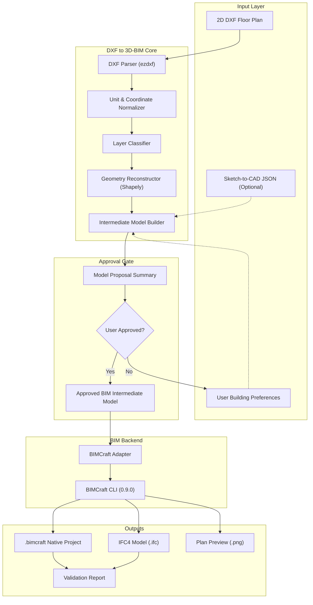

# DXF-to-3D-BIM Architecture

## Architectural Principles
1. **Engine Independence**: The interpretation layer extracts drawing entities into a normalized, versioned intermediate model (`bim-model.schema.json`). The geometry reconstruction does not directly depend on BIMCraft specifics.
2. **Deterministic Geometry**: Centerline pairing, polygon closing, snapping, and host projection are handled mathematically via Shapely and computational geometry algorithms, not probabilistic model guesses.
3. **Mandatory Approval Gate**: An intermediate model must be approved before BIMCraft commands are synthesized.
4. **Adapter Pattern**: The `BIMCraftAdapter` translates the approved intermediate model into atomic BIMCraft CLI commands or scripts.

## System Diagram

