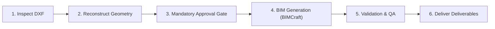

# DXF-to-3D-BIM

## Purpose
Convert 2D architectural floor plan DXF files—either generated upstream by `Sketch-to-CAD` or supplied independently—into editable 3D Building Information Models (BIM) using BIMCraft. Generates genuine semantic BIM objects (Levels, Exterior/Interior Walls, Hosted Doors & Windows, Floor Slabs, Rooms, and Roofs), verifies geometric topology, and exports native `.bimcraft` and standard `IFC4` deliverables.

## Activation Criteria
Activate this skill when:
- The user provides a 2D DXF architectural floor plan and requests a 3D BIM model, IFC export, or BIMCraft project.
- The user completes a `Sketch-to-CAD` workflow and proceeds to 3D model generation.
- The user asks to convert CAD floor plans to IFC, 3D architecture, or BIMCraft.

## Mandatory Principles
1. **Semantic BIM, Not Extruded Linework**: Never convert raw CAD lines directly into arbitrary meshes or generic solids. Always reconstruct wall centerlines, thicknesses, and hosted relationships to generate genuine BIMCraft elements (`wall`, `door`, `window`, `floor`, `level`).
2. **Mandatory Human Approval Gate**: 2D floor plans do not contain vertical elevation data (storey height, window sill height, door height, roof pitch). The agent MUST present an intermediate model proposal with explicit assumptions and obtain user approval before generating BIM elements.
3. **Upstream Schema Alignment**: Seamlessly accept `floor-plan-model.json` from `Sketch-to-CAD` when available, while also supporting standalone third-party DXFs via configurable layer classification.
4. **Independent Model Validation**: Verify generated `.bimcraft` and `IFC4` models by re-opening and checking element counts, storey associations, and geometry consistency before reporting completion.
5. **Engineering & Structural Boundary**: All generated structural elements (beams, columns, slabs) are conceptual for spatial coordination. Never claim structural safety, code compliance, or licensed engineering certification.

## Inputs
- **Required**:
  - Architectural DXF file (`.dxf`).
- **Optional**:
  - Upstream structured floor plan JSON (`floor-plan-model.json`).
  - Source sketch or preview image (`.png` / `.jpg`).
  - User-specified vertical heights (storey height, door/window heights).

## Workflow Stages

### Stage 1: Inspect DXF
- Parse drawing units, header variables, layers, extents, and supported entity types.
- Detect units; if missing or ambiguous, confirm with the user.
- Refer to [`workflows/inspect-dxf.md`](file:///d:/Agent%20Skills/DXF%20to%203D-BIM/skills/dxf-to-3d-bim/workflows/inspect-dxf.md).

### Stage 2: Reconstruct Geometry
- Classify layers using [`references/dxf-layer-mapping.md`](file:///d:/Agent%20Skills/DXF%20to%203D-BIM/skills/dxf-to-3d-bim/references/dxf-layer-mapping.md).
- Reconstruct wall centerlines, measure thicknesses, snap L- and T-junctions, and host doors/windows onto host walls.
- Produce intermediate model conforming to [`schemas/bim-model.schema.json`](file:///d:/Agent%20Skills/DXF%20to%203D-BIM/skills/dxf-to-3d-bim/schemas/bim-model.schema.json).
- Refer to [`workflows/reconstruct-geometry.md`](file:///d:/Agent%20Skills/DXF%20to%203D-BIM/skills/dxf-to-3d-bim/workflows/reconstruct-geometry.md).

### Stage 3: Mandatory User Approval Gate
- Present the reconstructed footprint, wall counts, door/window counts, inferred storey heights, and uncertainty log to the user.
- **DO NOT proceed to BIMCraft construction without explicit user approval.**
- Record approval conforming to [`schemas/approval.schema.json`](file:///d:/Agent%20Skills/DXF%20to%203D-BIM/skills/dxf-to-3d-bim/schemas/approval.schema.json).
- Refer to [`workflows/approve-model.md`](file:///d:/Agent%20Skills/DXF%20to%203D-BIM/skills/dxf-to-3d-bim/workflows/approve-model.md).

### Stage 4: BIM Generation (BIMCraft Backend)
- Execute verified BIMCraft CLI commands or MCP tools.
- Construct elements in strict order: Levels → Walls → Slabs → Hosted Doors/Windows → Rooms → Roofs.
- Save native project (`.bimcraft`), export standard IFC4 (`.ifc`), and render plan preview (`.png`).
- Refer to [`workflows/generate-bim.md`](file:///d:/Agent%20Skills/DXF%20to%203D-BIM/skills/dxf-to-3d-bim/workflows/generate-bim.md).

### Stage 5: Validation & Quality Assurance
- Independently inspect the generated `.bimcraft` and `.ifc` models using `bimcraft-cli info`.
- Verify element counts, storey associations, non-zero file sizes, and visual plan alignment.
- Produce validation report conforming to [`schemas/validation-report.schema.json`](file:///d:/Agent%20Skills/DXF%20to%203D-BIM/skills/dxf-to-3d-bim/schemas/validation-report.schema.json).
- Refer to [`workflows/validate-bim.md`](file:///d:/Agent%20Skills/DXF%20to%203D-BIM/skills/dxf-to-3d-bim/workflows/validate-bim.md).

### Stage 6: Deliver Deliverables
- Package `.bimcraft`, `.ifc`, `.png`, and validation report.
- Deliver summary report with explicit verification status and professional review notices.
- Refer to [`workflows/export-deliverables.md`](file:///d:/Agent%20Skills/DXF%20to%203D-BIM/skills/dxf-to-3d-bim/workflows/export-deliverables.md).

## Error Recovery
- **Missing Units**: Request user confirmation or reference dimension before geometry scaling.
- **Unassociated Openings**: Log as unhosted openings in intermediate model; do not generate disconnected doors/windows.
- **BIMCraft Execution Failure**: Halt immediately, preserve intermediate JSON and execution logs, and report actionable CLI output.
- **Approval Rejection**: Update intermediate model based on user feedback and reset status to `awaiting_approval`.

