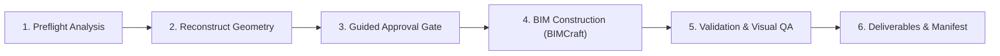

# DXF-to-3D-BIM

## Purpose
Convert arbitrary 2D architectural floor plan DXF files—either generated upstream by `Sketch-to-CAD` or supplied independently—into editable 3D Building Information Models (BIM) using BIMCraft 0.9.0. Generates genuine semantic BIM objects (Levels, Exterior/Interior Walls, Hosted Doors & Windows, Floor Slabs, Rooms), verifies geometric topology, and exports native `.bimcraft` and standard `IFC4` deliverables with comprehensive run manifests.

## Activation Criteria
Activate this skill when:
- The user provides a 2D DXF architectural floor plan and requests a 3D BIM model, IFC export, or BIMCraft project.
- The user completes a `Sketch-to-CAD` workflow and proceeds to 3D model generation.
- The user asks to convert CAD floor plans to IFC, 3D architecture, or BIMCraft.
- The user requests preflight inspection or validation of CAD floor plan geometry.

## Mandatory Principles
1. **Universal Preflight Audit**: Always audit drawings before construction. Inspect units ($INSUNITS), detect unit ambiguity, evaluate scale confidence, check modelspace vs. paperspace, and flag unclassified layers or unsupported entities.
2. **Never Guess Ambiguous Units Silently**: If $INSUNITS is 0 or absent, flag the ambiguity, provide heuristic suggestions based on extents, and obtain user confirmation or configuration override.
3. **Semantic BIM, Not Extruded Linework**: Never convert raw CAD lines directly into arbitrary meshes or generic solids. Always reconstruct wall centerlines, thicknesses, and hosted relationships to generate genuine BIMCraft elements (`wall`, `door`, `window`, `floor`, `level`). Collinear wall segments are automatically merged across opening gaps.
4. **Mandatory Human Approval Gate**: 2D floor plans do not contain vertical elevation data (storey height, window sill height, door height, slab thickness). The agent MUST present an intermediate model proposal structured across 7 logical sections and obtain user approval before generating BIM elements.
5. **Deterministic Approval Integrity**: Approvals are cryptographically locked using SHA-256 hashes of the model, DXF, and configuration. If inputs change after approval, the approval is invalidated.
6. **Independent Model Validation**: Verify generated `.bimcraft` and `IFC4` models by re-opening and checking element counts, opening voiding/filling relationships (`IfcRelVoidsElement`, `IfcRelFillsElement`), storey containment (`IfcRelContainedInSpatialStructure`), and visual plan alignment.
7. **Traceable Deliverables Package**: Organize outputs into `analysis/`, `models/`, `previews/`, `reports/`, and a top-level `manifest.json`.
8. **Engineering & Structural Boundary**: All generated structural elements (beams, columns, slabs) are conceptual for spatial coordination. Never claim structural safety, code compliance, or licensed engineering certification.

## Inputs
- **Required**:
  - Architectural DXF file (`.dxf`).
- **Optional**:
  - Upstream structured floor plan JSON (`floor-plan-model.json`).
  - Project configuration JSON (`--config path/to/config.json`).
  - Explicit unit override (`--unit mm|m|ft|in`).
  - Source sketch or preview image (`.png` / `.jpg`).

## CLI Workflow & Execution

### Preflight Inspection
```powershell
dxf-to-3d-bim inspect path\to\plan.dxf --out-json preflight.json --out-md preflight.md
```

### Guided Interactive One-Command Run
```powershell
# Single-storey floor plan
dxf-to-3d-bim run path\to\plan.dxf --out deliverables

# Two-storey building with repeated ground floor
dxf-to-3d-bim run path\to\plan.dxf --storeys 2 --repeat-ground-floor --out deliverables

# Multi-storey with custom storey height or configuration
dxf-to-3d-bim run path\to\plan.dxf --storeys 3 --storey-height 3200 --repeat-ground-floor --out deliverables
```

### Headless Automated Run (Non-Interactive)
```powershell
dxf-to-3d-bim run path\to\plan.dxf --out deliverables --non-interactive --config approved-config.json
dxf-to-3d-bim run path\to\plan.dxf --storeys 2 --repeat-ground-floor --auto-approve --out deliverables
```

## Workflow Stages



### Stage 1: Preflight Analysis
- Inspect DXF header, modelspace entities, layer classifications, and external references (XREFs).
- Check scale confidence and flag unit ambiguity if $INSUNITS is missing or 0.
- Generate `analysis/preflight_report.json` and `analysis/preflight_report.md`.
- Refer to [`workflows/inspect-dxf.md`](file:///d:/Agent%20Skills/DXF%20to%203D-BIM/skills/dxf-to-3d-bim/workflows/inspect-dxf.md).

### Stage 2: Reconstruct Geometry
- Classify layers using [`references/dxf-layer-mapping.md`](file:///d:/Agent%20Skills/DXF%20to%203D-BIM/skills/dxf-to-3d-bim/references/dxf-layer-mapping.md).
- Reconstruct wall centerlines, bridge opening gaps along collinear lines, and host doors/windows within host wall bounds.
- Support **Multi-Storey Reconstruction**:
  - **Mode A (DXF Storey Layers)**: Automatically partitions geometry across storeys when layer qualifiers like `L1-WALL`, `L2-WALL`, `FL01-`, or `STOREY_2_` are present.
  - **Mode B (Configured / Repeated Storeys)**: Reconstructs multi-storey buildings via CLI flags (`--storeys`, `--storey-height`, `--ground-elevation`, `--repeat-ground-floor`, `--storey-config`). Silent replication without explicit approval or configuration is strictly prohibited.
- Produce intermediate model conforming to [`schemas/bim-model.schema.json`](file:///d:/Agent%20Skills/DXF%20to%203D-BIM/skills/dxf-to-3d-bim/schemas/bim-model.schema.json).
- Refer to [`workflows/reconstruct-geometry.md`](file:///d:/Agent%20Skills/DXF%20to%203D-BIM/skills/dxf-to-3d-bim/workflows/reconstruct-geometry.md).

### Stage 3: Guided Approval Gate
- Present the 7 architectural sections: Units/Scale, Walls, Openings, Slab, Storeys, Warnings, and Deliverables.
- In interactive mode: allow user to accept, edit parameters, or cancel.
- In non-interactive mode: verify pre-approved configuration and DXF hash match without terminal pauses.
- Record version-locked approval in `analysis/approval_record.json` conforming to [`schemas/approval.schema.json`](file:///d:/Agent%20Skills/DXF%20to%203D-BIM/skills/dxf-to-3d-bim/schemas/approval.schema.json).
- Refer to [`workflows/approve-model.md`](file:///d:/Agent%20Skills/DXF%20to%203D-BIM/skills/dxf-to-3d-bim/workflows/approve-model.md).

### Stage 4: BIM Construction (BIMCraft Backend)
- Execute verified BIMCraft CLI 0.9.0 commands (`wall`, `floor`, `door`, `window`, `elevation`, `section`, `render`).
- Construct elements in strict order: Levels → Walls → Slabs → Hosted Doors/Windows → Rooms.
- Save native project into `models/<project>.bimcraft` and export standard IFC4 into `models/<project>.ifc`.
- Render plan preview into `previews/<project>.png`, 3D axonometric into `previews/<project>_3d.png`, and elevations/sections.
- Refer to [`workflows/generate-bim.md`](file:///d:/Agent%20Skills/DXF%20to%203D-BIM/skills/dxf-to-3d-bim/workflows/generate-bim.md).

### Stage 5: Validation & Visual QA
- Independently inspect the generated `.bimcraft` and `.ifc` models using `bimcraft-cli info` and `PureIfcParser`.
- Verify opening voiding (`IfcRelVoidsElement`), filling (`IfcRelFillsElement`), and storey containment.
- Generate CAD-to-BIM visual comparison overlay `previews/<project>_comparison_overlay.png`.
- Produce validation report conforming to [`schemas/validation-report.schema.json`](file:///d:/Agent%20Skills/DXF%20to%203D-BIM/skills/dxf-to-3d-bim/schemas/validation-report.schema.json).
- Refer to [`workflows/validate-bim.md`](file:///d:/Agent%20Skills/DXF%20to%203D-BIM/skills/dxf-to-3d-bim/workflows/validate-bim.md).

### Stage 6: Deliverables & Manifest
- Package all artifacts into `analysis/`, `models/`, `previews/`, and `reports/`.
- Generate `manifest.json` recording toolchain versions, artifact SHA-256 hashes, file sizes, and run status.
- Generate human review summary `reports/review_summary.md`.
- Refer to [`workflows/export-deliverables.md`](file:///d:/Agent%20Skills/DXF%20to%203D-BIM/skills/dxf-to-3d-bim/workflows/export-deliverables.md).

## Error Recovery
- **Missing / Ambiguous Units**: In interactive mode, prompt user for unit confirmation. In non-interactive mode, halt immediately with actionable message unless `--unit` or `units.source_unit` in `--config` is supplied.
- **Empty Drawing or Annotations-Only**: Preflight detects lack of wall linework, marks preflight FAILED, and halts before geometry reconstruction.
- **Corrupt DXF File**: Preflight catches parser/structure errors, writes failed manifest, and directs user to recover file in CAD.
- **Overlapping Openings**: Automatically deduplicate overlapping openings on the same host wall to maintain physical BIM validity.
- **BIMCraft Execution Failure**: Halt immediately, capture stderr/stdout, save failure record into `manifest.json`, and exit with code 1.
- **Approval Rejection**: If user cancels approval, save status `REJECTED` into `manifest.json` and exit with code 2.
